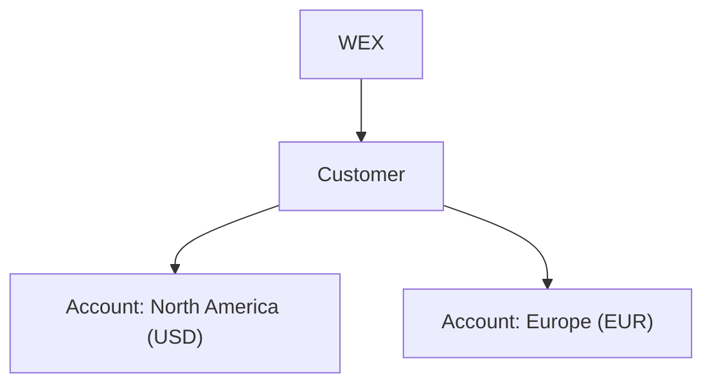

# Product foundation

What WEX Business Payments (WBP) is, who it's for, and how it's structured. Every screen and flow starts from this. It also outlines the case study's first problem, "A broken foundation."

Details and their reasoning live in `docs/design/` (mainly `decisions.md` and `glossary.md`). This file summarizes; if the two disagree, `docs/design/` wins.

## The product

WBP helps mid-market businesses issue cards, control spend, and pay suppliers. It replaces a legacy platform that was slow, hard to learn, and built around internal terms instead of customers' work.

The prototype is built for **direct customers**: businesses that use WEX themselves, rather than partners who build WEX into their own products.

## Customers

Direct customers are larger small businesses and mid-market companies in industries like event ticketing, marketing, healthcare, construction and retail. They use WBP often, to manage card programs and pay suppliers.

Most have fewer than 10 accounts, and many have just one. The product has to feel simple for a single-account customer and still scale to a multi-entity one.

## Products

| Product | What it covers |
|---|---|
| Cards | Virtual cards: single-use cards for one purchase and reusable cards assigned to a person or department. Physical corporate cards are an option. |
| Payments | Paying suppliers and bills, by virtual card and other payment methods. |

Each account has Cards, Payments or both turned on. Anything a customer doesn't use is hidden everywhere, so a payments-only customer never sees cards.

## Structure

**Before.** The legacy platform had three tiers: Org Group, then Orgs, then Companies. Different features lived at different tiers. People worked at the Org level, but credit lines, currencies and statements sat on the Companies below, so every new card or payment needed a Company picked. Setups varied by customer: some had no Org Group, and large partners were squeezed into a single one.

**After.** Two levels, the same for every customer:

- **Customer:** the business with the WEX relationship. Users belong here.
- **Account:** one credit line, one currency, one statement. Cards and payments are created in the account that pays for them. Customers split accounts however they need to, by entity, by region or another way.
- **Department:** a label on cards and users within an account, used for filtering, reporting and approvals. It's not a level.
- **All accounts:** admins with more than one account can view combined spend, rebates and reports. Actions still happen inside one account. Single-account customers never see the switcher.

Partners would sit one level up (Partner → Customer → Account). That appears in the case study as a diagram, not as screens.

## Users and roles

Each user has exactly one role. Access is set separately: which accounts, and for managers, optionally which departments.

| Role | What they do |
|---|---|
| Admin | Everything, including users, settings and spend controls |
| Manager | Daily operations for the products they manage. Shown as Card manager, Payment manager, or Card and payment manager |
| Finance manager | Views spend, statements, rebates and reports, and pays statements |
| Cardholder | Only their own cards, transactions, PIN and disputes |

- **Cards and roles are separate.** Any user can hold cards and sees My cards. Cardholder is the role for people who need nothing else.
- **Every card belongs to a user.** Issuing a card to a new person creates and invites them, so cards never need to be connected to people later. Cards never move between people.
- **Customers never see individual permissions.** Each role has a plain-language summary. The detailed permissions are tracked in one internal table, filled in as screens are designed.

**Before.** Customers built their own roles from about 300 individually listed permissions, most in internal terms. Users could stack several roles, and users were created at different tiers, so admins couldn't see some of their own cardholders. Most customers ended up with near-identical roles anyway.

## Top jobs

| Role | Jobs |
|---|---|
| Admin | Add people and set their access. Set spend controls. See spend against credit. Track rebates. |
| Card manager | Issue virtual cards with spend controls. Order physical cards. Freeze, close or replace cards. Understand and resolve declines. |
| Payment manager | Pay suppliers. Keep supplier details current. Find a payment and fix exceptions. |
| Finance manager | Reconcile statements. Export transactions. Pay the statement. Track rebates. |
| Cardholder | See card details and available limit. Check transactions. Manage the PIN. Dispute a charge. Understand why a card was declined. |

## Performance

The legacy platform was slow enough that people abandoned tasks. The backend isn't part of the redesign, so the interface loads less by default:

- Activity tables show the last 30 days.
- Inactive records, such as closed cards, are hidden.
- People can widen the range, show inactive records, and change rows per page.

## The case study's problems

1. **A broken foundation:** structure, roles and performance. Covered in this file.
2. **Navigation, terminology and self-service:** navigation built around how customers work, plain language, standard roles, a cardholder view, and one status system.
3. **Outdated UI and workflows:** stepped forms, search and filtering, bulk actions, and declines explained in plain language.
4. **Dashboard and rebate visibility:** a dashboard that shows spend, what needs attention, and rebates earned and available.

## Goals and non-goals

**Goals**
- One structure every customer is set up in, and every feature fits.
- A product that shows only what each customer and role uses.
- People understand their own access without training.

**Non-goals for the prototype**
- Partner and bank screens.
- Custom roles, cross-account bulk actions, and nested department trees.
- Backend performance work.

## Case study visuals this supports

- Hierarchy before and after.
- How a legacy setup maps to the new one: Companies with their own credit line become Accounts, and other Orgs become Departments.
- Roles before and after: hundreds of permissions compared with four roles and a summary.
- User management problems the new model removes: invisible cardholders, blank roles, and cards that had to be connected to people later.
- Table loading defaults.
